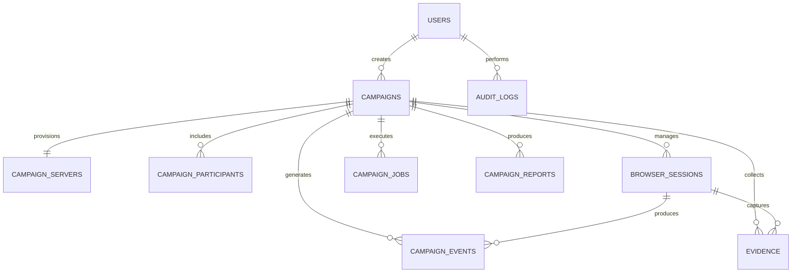

from pathlib import Path

content = r"""# PHISHGUARD — Technical Architecture & Implementation Blueprint

**Version:** 1.0  
**Project type:** Internal phishing simulation and investigation platform  
**Architecture:** Laravel control plane + standalone Python remote agent + RabbitMQ  
**Deployment model:** One dedicated remote server per campaign

---

## 1. Project overview

PHISHGUARD is a distributed cybersecurity training and investigation platform. It supports two operating modes:

1. **Simulation mode:** Run controlled phishing-awareness exercises using approved participants, synthetic accounts, and purpose-built lab websites.
2. **Investigation mode:** Let analysts inspect suspicious websites in isolated remote browser environments, analyze behavior, and collect forensic evidence.

The platform is designed for an internal cybersecurity team. Laravel is the central control plane. A standalone Python agent is deployed to a dedicated remote server over SSH for each campaign. Laravel and the agent communicate asynchronously through RabbitMQ.

**Safety boundary:** Demonstrations of keylogging, credential harvesting, and session theft use synthetic lab data and purpose-built test applications. The platform must not export real browser passwords, cookies, session tokens, or private keystrokes.

## 2. Architecture at a glance

```text
                         CENTRAL INFRASTRUCTURE
┌────────────────────────────────────────────────────────────────┐
│                         Laravel Control Plane                  │
│  Campaigns · Users/RBAC · SSH Provisioner · API · Dashboard     │
│  Event Processor · Audit Logs · Reports                         │
└──────────────────────────────┬─────────────────────────────────┘
                               │ AMQPS
                  ┌────────────┴────────────┐
                  │        RabbitMQ         │
                  │ Commands  ↔  Events     │
                  └────────────┬────────────┘
                               │ AMQPS
                               ▼
                   DEDICATED CAMPAIGN SERVER
┌────────────────────────────────────────────────────────────────┐
│                       Python Remote Agent                       │
│  Lifecycle · RabbitMQ · Health · Docker orchestration           │
│                                                                │
│  ┌───────────────────┐  ┌────────────────────┐                  │
│  │ Browser container │  │ Analysis container │                  │
│  │ Chromium/Playwright│ │ URL/DOM/file checks │                 │
│  │ Xvfb + noVNC      │  │ Phishing indicators │                  │
│  └───────────────────┘  └────────────────────┘                  │
│                                                                │
│  ┌───────────────────┐  ┌────────────────────┐                  │
│  │ Evidence processor│  │ Quarantine storage │                  │
│  │ Hashing/scanning  │  │ Temporary artifacts│                  │
│  └───────────────────┘  └────────────────────┘                  │
└────────────────────────────────────────────────────────────────┘
                               │ HTTPS
                               ▼
                  Laravel Evidence API / Object Storage
```

### Component responsibilities

| Component | Responsibility |
|---|---|
| Laravel | Business logic, campaign orchestration, API, dashboard, authorization |
| SSH provisioner | Remote installation and deployment |
| Python agent | Remote execution, lifecycle, health, messaging |
| RabbitMQ | Asynchronous command and event transport |
| Docker | Campaign environment isolation |
| Chromium | Browser environment |
| noVNC | Remote browser viewing |
| Playwright | Browser automation and event instrumentation |
| Security analyzer | URL, redirect, DOM, and file analysis |
| PostgreSQL | Persistent application data |
| Object storage | Screenshots, reports, and approved evidence |

The Python agent is a reusable deployment artifact. It should not contain campaign-specific business logic or depend on Laravel's internal code or database.

## 3. Campaign lifecycle

Each campaign receives one dedicated remote server and an isolated Docker environment.

1. Laravel creates a campaign with status `pending`.
2. A queued Laravel job validates the remote server.
3. Laravel connects through SSH using a dedicated deployment account.
4. A bootstrap process installs Docker and required dependencies.
5. Laravel deploys a signed, versioned Python agent release.
6. The agent registers its identity and connects to RabbitMQ over TLS.
7. Laravel publishes `activate_campaign`.
8. The agent validates the configuration and starts campaign containers.
9. The agent checks browser, noVNC, analyzer, and evidence-service health.
10. The agent publishes `activate_campaign_results`.
11. Laravel marks the campaign active and continues receiving heartbeats.
12. Stop and delete operations are explicit, separate lifecycle commands.

### Campaign states

```text
pending
  └── provisioning
        └── deploying
              └── starting
                    └── active
                          └── stopping
                                └── stopped
                                      └── deleting
                                            └── deleted

Any non-terminal state may transition to failed when an unrecoverable error occurs.
```

Enforce valid state transitions in Laravel. Do not accept arbitrary status updates from clients or agents.

## 4. Laravel database architecture

Use PostgreSQL. Keep relational campaign metadata in the database and large evidence files in object storage.

### 4.1 Entity relationship diagram



### 4.2 Tables

#### `campaigns`

| Column | Type | Notes |
|---|---|---|
| id | UUID | Primary key |
| created_by | UUID | User ID |
| name | VARCHAR | Campaign name |
| description | TEXT | Description |
| type | VARCHAR | `simulation` or `investigation` |
| status | VARCHAR | Lifecycle state |
| target_server_id | UUID, nullable | Associated remote server |
| configuration | JSONB | Validated campaign settings |
| started_at | TIMESTAMP, nullable | Start date |
| stopped_at | TIMESTAMP, nullable | Stop date |
| deleted_at | TIMESTAMP, nullable | Soft deletion |
| created_at | TIMESTAMP | Creation time |
| updated_at | TIMESTAMP | Last update |

#### `campaign_servers`

| Column | Type | Notes |
|---|---|---|
| id | UUID | Primary key |
| campaign_id | UUID | Campaign foreign key |
| hostname | VARCHAR | Server hostname |
| ip_address | INET | Server address |
| ssh_port | INTEGER | SSH port |
| ssh_user | VARCHAR | Restricted deployment account |
| ssh_key_reference | VARCHAR | Secret-manager reference, not private key |
| agent_id | UUID | Agent identity |
| agent_version | VARCHAR | Installed version |
| status | VARCHAR | Provisioning status |
| last_heartbeat_at | TIMESTAMP, nullable | Last heartbeat |
| provisioned_at | TIMESTAMP, nullable | Provisioning date |
| created_at | TIMESTAMP | Creation time |

#### `campaign_participants`

Suggested columns:

- `id` UUID primary key
- `campaign_id` UUID foreign key
- `user_id` UUID foreign key
- `participant_code` VARCHAR
- `assigned_at` TIMESTAMP
- `completed_at` TIMESTAMP nullable
- `consent_record_id` UUID nullable
- `status` VARCHAR

Do not store actual passwords or secrets submitted during training.

#### `browser_sessions`

Suggested columns:

- `id` UUID primary key
- `campaign_id` UUID foreign key
- `session_uuid` UUID unique
- `browser_type` VARCHAR
- `browser_version` VARCHAR nullable
- `status` VARCHAR
- `started_at` TIMESTAMP nullable
- `ended_at` TIMESTAMP nullable
- `last_activity_at` TIMESTAMP nullable
- `container_reference` VARCHAR nullable

#### `campaign_events`

| Column | Type | Notes |
|---|---|---|
| id | UUID | Primary key |
| campaign_id | UUID | Campaign foreign key |
| session_id | UUID, nullable | Session foreign key |
| event_id | UUID | Unique message/event ID |
| event_type | VARCHAR | Event name |
| severity | VARCHAR | Informational, low, medium, high, critical |
| payload | JSONB | Sanitized event details |
| occurred_at | TIMESTAMP | Event time |
| received_at | TIMESTAMP | Server receipt time |

Recommended indexes:

- `(campaign_id, occurred_at)`
- `(session_id, occurred_at)`
- `(event_type, occurred_at)`
- Unique index on `event_id`

#### `evidence`

Suggested columns:

- `id` UUID primary key
- `campaign_id` UUID foreign key
- `session_id` UUID nullable
- `evidence_type` VARCHAR
- `storage_key` VARCHAR
- `original_filename` VARCHAR nullable
- `mime_type` VARCHAR
- `file_size` BIGINT
- `sha256` CHAR(64)
- `scan_status` VARCHAR
- `captured_at` TIMESTAMP
- `retention_until` TIMESTAMP nullable

#### `campaign_jobs`

Suggested columns:

- `id` UUID primary key
- `campaign_id` UUID foreign key
- `job_uuid` UUID unique
- `action` VARCHAR
- `status` VARCHAR
- `attempt_count` INTEGER
- `requested_at` TIMESTAMP
- `started_at` TIMESTAMP nullable
- `completed_at` TIMESTAMP nullable
- `error_message` TEXT nullable

#### `campaign_reports`

Suggested columns:

- `id` UUID primary key
- `campaign_id` UUID foreign key
- `report_type` VARCHAR
- `report_data` JSONB
- `generated_at` TIMESTAMP
- `generated_by` UUID

#### `audit_logs`

Suggested columns:

- `id` UUID primary key
- `user_id` UUID nullable
- `campaign_id` UUID nullable
- `action` VARCHAR
- `resource_type` VARCHAR
- `resource_id` UUID nullable
- `metadata` JSONB
- `ip_address` INET nullable
- `created_at` TIMESTAMP

Record campaign creation, provisioning, activation, evidence access, evidence deletion, campaign deletion, and retention-policy changes.

### 4.3 Database recommendations

- Use UUIDs for externally visible identifiers.
- Use foreign keys and appropriate cascade/restrict behavior.
- Never store private SSH keys directly in database columns.
- Store references to encrypted secrets in a secret manager.
- Use Laravel encrypted casts for sensitive configuration where appropriate.
- Use a transactional outbox for reliable command publishing.
- Keep evidence files out of PostgreSQL.
- Apply retention policies and investigation holds.

## 5. RabbitMQ architecture

Use two topic exchanges:

- `phishguard.commands`
- `phishguard.events`

Laravel publishes commands and consumes events. The Python agent consumes commands and publishes events.

### 5.1 Logical queues

#### Laravel → Python

| Queue | Routing key | Purpose |
|---|---|---|
| `activate_campaign` | `campaign.activate` | Start campaign |
| `stop_campaign` | `campaign.stop` | Stop campaign |
| `delete_campaign` | `campaign.delete` | Remove campaign resources |

#### Python → Laravel

| Queue | Routing key | Purpose |
|---|---|---|
| `activate_campaign_results` | `campaign.activated` | Activation result |
| `stop_campaign_results` | `campaign.stopped` | Stop result |
| `delete_campaign_results` | `campaign.deleted` | Deletion result |
| `downloads` | `evidence.download` | Authorized lab download metadata |
| `notifications` | `session.notification` | Browser/session events |
| `keylog_demo` | `training.keylog_demo` | Synthetic keylogging exercise |
| `cookies_demo` | `training.cookies_demo` | Synthetic cookie exercise |
| `credentials_demo` | `training.credentials_demo` | Synthetic credential exercise |
| `phishing_detected` | `security.phishing_detected` | Detection alert |
| `evidence_uploaded` | `evidence.uploaded` | Evidence metadata |
| `agent_heartbeat` | `agent.heartbeat` | Agent health |

The `*_demo` queues carry controlled training results only. They must never carry real browser secrets.

### 5.2 Standard message envelope

Every message should follow a common schema:

```json
{
  "message_id": "uuid",
  "correlation_id": "uuid",
  "campaign_id": "uuid",
  "agent_id": "uuid",
  "event_type": "campaign.activated",
  "schema_version": 1,
  "timestamp": "2026-11-15T12:00:00Z",
  "payload": {}
}
```

Fields:

- `message_id`: unique ID for deduplication.
- `correlation_id`: links a command to its result.
- `campaign_id`: campaign isolation.
- `agent_id`: originating agent identity.
- `event_type`: event or command name.
- `schema_version`: contract version.
- `timestamp`: UTC timestamp.
- `payload`: validated event-specific data.

### 5.3 Command contracts

#### Activate campaign

```json
{
  "message_id": "uuid",
  "correlation_id": "uuid",
  "campaign_id": "uuid",
  "event_type": "campaign.activate",
  "schema_version": 1,
  "payload": {
    "mode": "investigation",
    "browser": {
      "engine": "chromium",
      "novnc_enabled": true
    },
    "resources": {
      "cpu_limit": 2,
      "memory_limit": "2g"
    },
    "features": {
      "url_analysis": true,
      "download_scanning": true,
      "event_monitoring": true
    }
  }
}
```

#### Activation result

```json
{
  "message_id": "uuid",
  "correlation_id": "uuid",
  "campaign_id": "uuid",
  "event_type": "campaign.activated",
  "schema_version": 1,
  "payload": {
    "status": "active",
    "browser_status": "ready",
    "novnc_status": "ready",
    "agent_version": "1.0.0"
  }
}
```

#### Stop campaign

```json
{
  "message_id": "uuid",
  "campaign_id": "uuid",
  "event_type": "campaign.stop",
  "schema_version": 1,
  "payload": {
    "reason": "manual_stop",
    "preserve_evidence": true
  }
}
```

#### Delete campaign

```json
{
  "message_id": "uuid",
  "campaign_id": "uuid",
  "event_type": "campaign.delete",
  "schema_version": 1,
  "payload": {
    "remove_containers": true,
    "remove_temporary_files": true,
    "preserve_evidence": true
  }
}
```

Deletion must not destroy evidence subject to retention requirements or investigation holds.

### 5.4 Notification contract

```json
{
  "message_id": "uuid",
  "campaign_id": "uuid",
  "event_type": "session.notification",
  "schema_version": 1,
  "payload": {
    "session_id": "uuid",
    "action": "user_joined",
    "timestamp": "2026-11-15T12:00:00Z",
    "metadata": {
      "browser": "chromium"
    }
  }
}
```

Supported actions:

- `user_joined`
- `user_left`
- `page_navigation`
- `click_activity`
- `form_interaction_detected`
- `download_started`
- `download_completed`
- `download_blocked`
- `session_idle`
- `session_error`

Record coarse interaction metadata only. Do not capture typed characters or passwords.

### 5.5 Reliability rules

Implement:

1. Durable queues.
2. Persistent messages.
3. Publisher confirms.
4. Manual consumer acknowledgements.
5. Idempotency using `message_id`.
6. Retry queues with exponential backoff.
7. Dead-letter exchanges.
8. Campaign-scoped routing and authorization.
9. TLS connections.
10. Consumer prefetch limits.
11. Transactional outbox in Laravel.
12. Explicit command expiration and timeout handling.

Duplicate command delivery must not create duplicate browser containers. The agent should persist command execution state so it can recover after restarts.

## 6. Python standalone agent

Use Python 3.12+ with asynchronous RabbitMQ messaging and validated message schemas.

### 6.1 Project structure

```text
phishguard-agent/
├── app/
│   ├── main.py
│   ├── config.py
│   ├── logging.py
│   ├── messaging/
│   │   ├── connection.py
│   │   ├── consumer.py
│   │   ├── publisher.py
│   │   ├── queues.py
│   │   └── retry.py
│   ├── campaign/
│   │   ├── manager.py
│   │   ├── lifecycle.py
│   │   ├── activation.py
│   │   ├── shutdown.py
│   │   └── cleanup.py
│   ├── browser/
│   │   ├── manager.py
│   │   ├── chromium.py
│   │   ├── novnc.py
│   │   ├── session.py
│   │   └── downloads.py
│   ├── monitoring/
│   │   ├── heartbeat.py
│   │   ├── session_events.py
│   │   └── health.py
│   ├── analysis/
│   │   ├── url_analyzer.py
│   │   ├── domain_analyzer.py
│   │   ├── redirect_analyzer.py
│   │   ├── dom_analyzer.py
│   │   └── phishing_detector.py
│   ├── evidence/
│   │   ├── manager.py
│   │   ├── screenshot.py
│   │   ├── file_scanner.py
│   │   ├── uploader.py
│   │   └── hashing.py
│   ├── training/
│   │   ├── synthetic_keylogger_demo.py
│   │   ├── synthetic_cookie_demo.py
│   │   └── synthetic_credentials_demo.py
│   ├── infrastructure/
│   │   ├── docker_manager.py
│   │   ├── container_health.py
│   │   └── resource_limits.py
│   └── schemas/
│       ├── commands.py
│       ├── events.py
│       └── messages.py
├── deployment/
│   ├── Dockerfile
│   ├── docker-compose.yml
│   └── bootstrap.sh
├── tests/
│   ├── test_lifecycle.py
│   ├── test_messaging.py
│   ├── test_analysis.py
│   └── test_cleanup.py
├── requirements.txt
├── pyproject.toml
├── .env.example
└── README.md
```

### 6.2 Module responsibilities

| Module | Responsibility |
|---|---|
| `main.py` | Start agent and supervise tasks |
| `messaging` | RabbitMQ connection and delivery |
| `campaign` | Lifecycle and state management |
| `browser` | Chrome, noVNC and sessions |
| `monitoring` | Heartbeats and session events |
| `analysis` | Phishing detection |
| `evidence` | Evidence capture and transfer |
| `training` | Safe synthetic attack demonstrations |
| `infrastructure` | Docker and health management |
| `schemas` | Pydantic message validation |

### 6.3 Python dependencies

```text
aio-pika
pydantic
pydantic-settings
docker
playwright
httpx
structlog
tenacity
python-json-logger
pytest
pytest-asyncio
```

Pin dependency versions in the production lock file. Install Playwright's browser binaries as part of the versioned image build.

Avoid giving the Python agent unrestricted access to the host Docker socket. Prefer a narrowly scoped privileged supervisor or restricted container-management API.

## 7. Browser and Docker architecture

Use separate containers for the browser, analysis, and evidence processing.

```text
Campaign Docker network
┌────────────────────────────────────────────┐
│ Browser container                          │
│ Chromium · Playwright · Xvfb · noVNC       │
└──────────────────────┬─────────────────────┘
                       │ controlled interface
┌──────────────────────▼─────────────────────┐
│ Analysis container                         │
│ URL analysis · DOM inspection · File checks│
└──────────────────────┬─────────────────────┘
                       │ validated metadata/files
┌──────────────────────▼─────────────────────┐
│ Evidence processor                         │
│ Quarantine · Hashing · Authenticated upload│
└────────────────────────────────────────────┘
```

### 7.1 Suggested containers

| Container | Technology | Purpose |
|---|---|---|
| `browser` | Chromium + Playwright | Browser execution |
| `novnc` | noVNC + Xvfb | Remote viewing |
| `analyzer` | Python | Threat inspection |
| `evidence` | Python | Evidence processing |
| `agent` | Python | Campaign orchestration |

Chrome and noVNC may share a browser image. Keep analysis and evidence processing isolated.

### 7.2 Browser isolation requirements

- Non-root browser user.
- No privileged containers.
- Read-only root filesystem where practical.
- CPU, memory, and process limits.
- Separate network per campaign.
- Restricted outbound traffic.
- Block private IP ranges, loopback, link-local, and cloud metadata endpoints.
- Revalidate redirect destinations.
- No access to host filesystem or Docker socket.
- Disable browser password saving and autofill.
- Use disposable browser profiles.
- Destroy temporary profiles after campaign completion.

Enforce SSRF protection at the network layer, not only through Python URL validation. Account for DNS rebinding and redirect chains.

### 7.3 noVNC access

Do not expose noVNC directly to the public internet.

Use:

- Authenticated Laravel session.
- Short-lived, single-use access token.
- Reverse proxy.
- HTTPS/WSS.
- Campaign-level authorization.
- Session expiration.
- Audit logging.

Access flow:

```text
Analyst
  → Laravel authentication
  → Generate temporary access token
  → Authorized reverse proxy
  → Remote noVNC session
```

## 8. Laravel application architecture

Start with a modular monolith. Microservices are not necessary on the Laravel side for the first release.

### 8.1 Suggested project structure

```text
app/
├── Domain/
│   ├── Campaigns/
│   │   ├── Models/
│   │   ├── Actions/
│   │   ├── Services/
│   │   ├── Events/
│   │   └── Enums/
│   ├── Infrastructure/
│   │   ├── Models/
│   │   ├── SSH/
│   │   ├── Provisioning/
│   │   └── Docker/
│   ├── Messaging/
│   │   ├── RabbitMQ/
│   │   ├── Publishers/
│   │   ├── Consumers/
│   │   └── Contracts/
│   ├── Browser/
│   │   ├── Services/
│   │   └── Sessions/
│   ├── Evidence/
│   │   ├── Models/
│   │   ├── Services/
│   │   └── Storage/
│   ├── Analysis/
│   │   ├── Services/
│   │   └── Reports/
│   └── Audit/
├── Jobs/
├── Http/
│   ├── Controllers/
│   ├── Requests/
│   └── Resources/
└── Providers/
```

### 8.2 Main Laravel services

| Service | Main responsibilities |
|---|---|
| `CampaignService` | Create, update, stop, delete |
| `ProvisioningService` | Connect, bootstrap, deploy |
| `SSHService` | Execute approved commands and upload artifacts |
| `RabbitMQPublisher` | Publish commands |
| `RabbitMQConsumer` | Consume agent events |
| `AgentService` | Register, heartbeat, health |
| `BrowserSessionService` | Create, access, close |
| `EvidenceService` | Validate, store, retrieve |
| `ReportService` | Generate reports |

### 8.3 Suggested API endpoints

| Method | Endpoint | Purpose |
|---|---|---|
| POST | `/api/campaigns` | Create campaign |
| GET | `/api/campaigns` | List campaigns |
| GET | `/api/campaigns/{id}` | Campaign details |
| POST | `/api/campaigns/{id}/provision` | Provision server |
| POST | `/api/campaigns/{id}/activate` | Activate |
| POST | `/api/campaigns/{id}/stop` | Stop |
| DELETE | `/api/campaigns/{id}` | Delete |
| GET | `/api/campaigns/{id}/events` | Event timeline |
| GET | `/api/campaigns/{id}/evidence` | Evidence list |
| GET | `/api/campaigns/{id}/sessions` | Browser sessions |
| POST | `/api/campaigns/{id}/access-token` | Generate noVNC token |
| GET | `/api/campaigns/{id}/report` | Campaign report |

Enforce role-based authorization and campaign access policies on every endpoint.

## 9. SSH provisioning

Laravel should orchestrate installation through queued jobs, not execute a large shell script inside a controller.

### Provisioning sequence

```text
CreateCampaignJob
       |
       v
Validate remote server
       |
       v
Establish SSH connection
       |
       v
BootstrapServerJob
       |
       v
Install Docker and dependencies
       |
       v
Deploy Python agent
       |
       v
Register agent identity
       |
       v
Configure campaign environment
       |
       v
Publish activate_campaign
       |
       v
Wait for readiness result
       |
       v
Campaign ACTIVE
```

### Versioned deployment

```text
releases/
  1.0.0/
  1.0.1/
  1.1.0/

current -> releases/1.1.0
```

Deploy a signed agent release, verify its checksum, configure it, and start it. This supports reproducible deployments, version tracking, rollbacks, and debugging.

### SSH security

- Dedicated restricted deployment account.
- Narrowly scoped privileged installer for Docker installation.
- SSH host-key verification.
- Per-server credentials.
- No password-based root login.
- Command allowlisting.
- Deployment logs and timeouts.
- Explicit failure recovery.
- Never accept arbitrary shell commands through RabbitMQ.

## 10. Phishing detection and forensic analysis

The analyzer should produce explainable findings rather than treating every suspicious page as malicious.

### Detection pipeline

1. Collect the current URL and navigation chain.
2. Analyze domain reputation, DNS, certificate metadata, domain age, and typosquatting indicators.
3. Inspect HTTP and browser redirect chains.
4. Inspect sanitized DOM data for suspicious form actions, external scripts, hidden frames, and misleading page elements.
5. Hash downloaded files, identify file types, and scan in quarantine.
6. Combine indicators into an explainable risk assessment.
7. Generate evidence with timestamps, screenshots, URLs, hashes, and findings.

### Example detection result

```json
{
  "url": "https://example-lab.test/login",
  "risk_score": 87,
  "classification": "suspicious",
  "indicators": [
    {
      "type": "external_form_action",
      "severity": "high",
      "description": "Form submits to an unrelated domain"
    },
    {
      "type": "domain_similarity",
      "severity": "medium",
      "description": "Domain resembles a known organization"
    },
    {
      "type": "suspicious_redirect",
      "severity": "high",
      "description": "Unexpected cross-domain redirect"
    }
  ]
}
```

Risk scores should be calibrated and explainable, not treated as proof of maliciousness.

### Evidence types

- Screenshots.
- URL and redirect history.
- Sanitized DOM snapshots.
- Network metadata.
- Download hashes.
- Browser event timeline.
- Analyzer results.
- Analyst notes.

Keep malware samples quarantined, access-controlled, and in a separate disposable analysis environment.

## 11. Controlled training demonstrations

The platform can teach keylogging, cookie theft, and credential harvesting through dedicated modules using synthetic lab data.

| Module | Demonstration | Defensive learning |
|---|---|---|
| Keylogging | Controlled input recorder in a synthetic application | Detect unauthorized input monitoring |
| Cookies | Synthetic session-token demonstration | HttpOnly, Secure, SameSite, session rotation |
| Credentials | Fake login form with dummy accounts | MFA, phishing-resistant authentication, password managers |

Example training result:

```json
{
  "exercise": "credential_harvesting_demo",
  "participant": "participant-014",
  "interaction": "submitted_synthetic_credentials",
  "password_collected": false,
  "training_result": "completed"
}
```

The dashboard reports exercise outcomes without collecting real secrets.

## 12. Infrastructure and deployment topology

### Central infrastructure

| Service | Purpose |
|---|---|
| Laravel server | API, dashboard, workers |
| PostgreSQL | Application database |
| RabbitMQ | Command/event broker |
| Redis | Laravel queues and cache |
| S3-compatible storage | Evidence and reports |

### Remote campaign infrastructure

Each campaign receives one dedicated server:

```text
Campaign server A
  Python agent A
  Browser A
  Analyzer A

Campaign server B
  Python agent B
  Browser B
  Analyzer B

Campaign server C
  Python agent C
  Browser C
  Analyzer C
```

### Network communication

| Connection | Direction |
|---|---|
| Laravel → remote server | SSH |
| Python agent → RabbitMQ | AMQPS |
| Laravel → RabbitMQ | AMQPS |
| Analyst → noVNC | HTTPS/WSS through authenticated proxy |
| Python → Laravel evidence API | HTTPS |
| Browser → external internet | Restricted egress |

The agent initiates its RabbitMQ connection. Laravel should not need to connect back to each remote server through inbound ports.

### Queue isolation

Use campaign-specific queues internally, for example:

```text
phishguard.commands.campaign-uuid
phishguard.events.campaign-uuid
```

Laravel routes commands to the relevant campaign agent. Each agent consumes only its assigned commands. Logical event names remain unchanged.

## 13. Security and reliability requirements

| Area | Requirement |
|---|---|
| Authentication | Unique agent identity |
| Authorization | Campaign-scoped access |
| Messaging | TLS and message validation |
| SSH | Host verification and restricted account |
| Containers | Non-root and resource-limited |
| Browser | Disposable profiles |
| Networking | Egress restrictions and SSRF protection |
| Evidence | Encrypted storage |
| Files | Quarantine and malware scanning |
| Secrets | Secret manager, no plaintext credentials |
| Auditing | Tamper-resistant administrative audit trail |
| Retention | Configurable evidence retention |
| Cleanup | Verified container and temporary-file removal |

Additional reliability requirements:

- Agent heartbeat every 30 seconds.
- Mark agents offline after a configurable missed-heartbeat threshold.
- Idempotent lifecycle operations.
- Recovery from interrupted deployments.
- Health checks for every service.
- Graceful campaign shutdown.
- Evidence preservation when a campaign stops.
- Explicit, auditable deletion.
- RabbitMQ reconnection with backoff.

## 14. Implementation roadmap

### Phase 1 — Laravel foundation

- Authentication and roles.
- PostgreSQL schema.
- Campaign CRUD.
- Campaign lifecycle state machine.
- Audit logging.

**Deliverable:** Working campaign management.

### Phase 2 — Python agent

- Standalone Python project.
- Pydantic message schemas.
- RabbitMQ connection.
- Command consumers.
- Event publishers.
- Heartbeat mechanism.

**Deliverable:** Laravel and Python communicate reliably.

### Phase 3 — SSH provisioning

- Server registration.
- SSH connectivity verification.
- Docker installation.
- Agent deployment.
- Version and checksum verification.
- Deployment status reporting.

**Deliverable:** Laravel can provision a remote server.

### Phase 4 — Browser infrastructure

- Chromium.
- noVNC.
- Playwright.
- Container health checks.
- Authenticated remote access.
- Session management.

**Deliverable:** Working remote browser per campaign.

### Phase 5 — Monitoring and evidence

- Navigation events.
- Session notifications.
- Download forwarding.
- Screenshots.
- Evidence hashing.
- Quarantine.

**Deliverable:** Forensic event timeline.

### Phase 6 — Phishing analyzer

- URL analysis.
- Domain analysis.
- Redirect inspection.
- DOM inspection.
- Suspicious form detection.
- Risk scoring.

**Deliverable:** Suspicious website investigation engine.

### Phase 7 — Training modules

- Synthetic credential demonstration.
- Synthetic cookie/session demonstration.
- Keylogging detection exercise.
- Controlled phishing simulations.
- Participant scoring.

**Deliverable:** Internal cybersecurity training environment.

### Phase 8 — Production hardening

- Load testing.
- Security testing.
- Deployment recovery.
- Retention policies.
- Monitoring and alerts.
- Documentation.

**Deliverable:** Production-ready PHISHGUARD.

## 15. Definition of done

| Test | Expected result |
|---|---|
| Create campaign | Campaign stored in PostgreSQL |
| Provision server | Docker and agent installed |
| Activate campaign | Browser and noVNC become healthy |
| Duplicate activation | No duplicate containers |
| Open session | Laravel receives notification |
| Visit suspicious URL | Analyzer generates findings |
| Download lab file | Evidence transferred and scanned |
| Stop campaign | Browser stops, evidence preserved |
| Restart agent | Agent reconnects and recovers state |
| Delete campaign | Containers and temporary data removed |
| Server unavailable | Campaign becomes degraded/failed with explanation |

## 16. First-release technology stack

| Component | Choice |
|---|---|
| Backend | Laravel |
| Frontend | Vue 3 or Nuxt |
| Database | PostgreSQL |
| Message broker | RabbitMQ |
| Laravel queues | Redis |
| Agent | Python 3.12+ |
| Async messaging | aio-pika |
| Validation | Pydantic |
| Browser | Chromium |
| Automation | Playwright |
| Remote access | noVNC |
| Containers | Docker Compose |
| Evidence storage | S3-compatible storage |
| Realtime UI | Laravel Reverb |
| Deployment | SSH + versioned releases |

## 17. Repository layout

```text
PHISHGUARD/
├── backend/
│   └── Laravel application
├── agent/
│   └── Standalone Python agent
├── infrastructure/
│   ├── rabbitmq/
│   ├── docker/
│   └── deployment/
├── contracts/
│   ├── commands/
│   └── events/
└── documentation/
    ├── architecture.md
    ├── messaging.md
    ├── deployment.md
    └── security.md
```

## 18. Recommended first implementation milestone

Build a small, complete vertical slice before implementing phishing detection or training modules:

**Create campaign → SSH deploy → Docker start → Chrome/noVNC ready → RabbitMQ confirmation → Laravel dashboard shows active.**

Recommended development order:

1. Define message contracts.
2. Build Laravel campaign management.
3. Build the Python RabbitMQ agent.
4. Test activation, stopping, and deletion without Docker.
5. Add SSH provisioning.
6. Add Docker and Chrome.
7. Add noVNC.
8. Add monitoring and analysis.

The communication protocol should be established before browser automation. This reduces integration risk and ensures the Python agent can be tested independently.

---

## Final architectural recommendation

Keep Laravel as the orchestrator, Python as the independent remote agent, and RabbitMQ as the command/event communication layer between them.

Do not make the Python agent depend on Laravel's internal code or database. Use versioned message contracts, campaign-specific routing, idempotent commands, and explicit lifecycle states.

This separation allows PHISHGUARD to scale its remote agents independently and eventually support different infrastructure providers without rewriting its browser or security-analysis modules.
"""

path = Path("/mnt/data/PHISHGUARD-Architecture.md")
path.write_text(content, encoding="utf-8")
print(f"Created: {path}\nSize: {path.stat().st_size:,} bytes")
